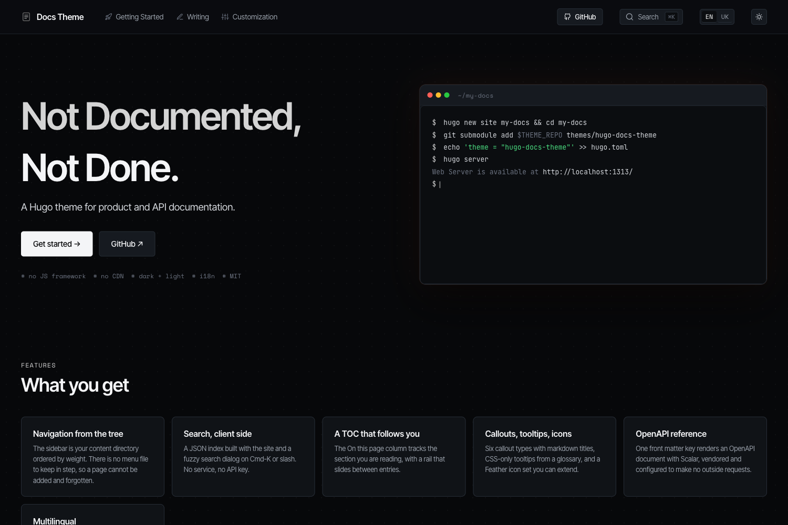

# Hugo Docs Theme

A documentation theme for [Hugo](https://gohugo.io). Dark first with a light
mode, an ink accent so colour on the page means status, and nothing loaded
from anybody else's server.



**Demo:** <https://yousysadmin.github.io/hugo-docs-theme/> - the demo site in
[`exampleSite/`](exampleSite) is also the documentation.

## Features

- **Sidebar from the directory tree**, ordered by `weight`. There is no menu
  file, so a page cannot be added and left out. Sections collapse, and the
  one holding the current page opens.
- **Client-side search** on <kbd>Cmd</kbd>/<kbd>Ctrl</kbd>+<kbd>K</kbd> or
  <kbd>/</kbd>, over a JSON index built with the site. Fuse.js is vendored.
- **"On this page"** with a scrollspy and a rail that slides between entries.
- **Callouts** (`note`, `info`, `tip`, `success`, `warning`, `danger`) with
  markdown titles, **tooltips** with a glossary, and an **icon** shortcode.
- **ASCII diagrams** in a fenced `ascii` block, dedented and centred.
- **Tables** that scroll on their own instead of overflowing the column.
- **Landing page** (hero, a terminal or an image beside it, features, section
  grid), optional.
- **OpenAPI reference** layout rendered by Scalar, vendored, configured to
  make no outside requests, and published only when used.
- **Changelog** layout, grouped by month.
- **Multilingual**: untranslated pages fall back to the original with a
  language tag, and a stale translation says so. Ships `en` and `uk`.
- **Works under a subpath** - root-relative links in the prose and links to
  content files resolve against `baseURL`.
- Self-hosted fonts, no JS framework, one CSS and one JS bundle, both
  fingerprinted.

## Requirements

Hugo **0.158.0** or newer. The standard edition is enough.

## Installation

### Hugo module

```toml
# hugo.toml
[module]
  [[module.imports]]
    path = "github.com/YouSysAdmin/hugo-docs-theme"
```

### Git submodule

```bash
git submodule add https://github.com/YouSysAdmin/hugo-docs-theme.git themes/hugo-docs-theme
```

```toml
# hugo.toml
theme = "hugo-docs-theme"
```

Clone the site with `--recurse-submodules`: without the theme, Hugo builds
blank pages and reports success.

## Configuration

Hugo merges a theme's `params` and `menus` into the site, **but not
`outputs` or `markup`**, so these belong in the site's own config:

```toml
baseURL = "https://docs.example.org/"
title = "My Project"
theme = "hugo-docs-theme"

# Required for search.
[outputs]
home = ["HTML", "JSON"]

[markup]
[markup.tableOfContents]
endLevel = 4
[markup.highlight]
style = "github-dark"   # code blocks stay dark in both themes

[params]
description = "What my project does"
repoURL = "https://github.com/me/my-project"
edit_base = "https://github.com/me/my-project/edit/main/docs/content/"
```

[`exampleSite/hugo.toml`](exampleSite/hugo.toml) states every parameter the
theme reads, with a comment on each, and the demo's
[configuration reference](exampleSite/content/en/reference/configuration.md)
lists them in tables.

## Content

```text
content/
  _index.md               home page (the documentation index)
  guides/
    _index.md             a section: title, description, weight, icon
    install.md            a page: title, description, weight
```

```yaml
---
title: Install
description: Shown under the title, on cards and in search results.
weight: 10
---
```

A section's `icon` is a file name under `assets/icons`. `sidebar: false`
hides a section, and `toc: false` hides a page's table of contents.

### Shortcodes

```go-html-template

Body in **markdown**.




CLI
TOML   <!-- data/tooltips.toml -->
```

### API reference

```yaml
---
title: API
layout: reference
openapi: openapi.json   # a page resource, a path under static/, or a URL
---
```

## Customization

| What | How |
| --- | --- |
| Colours, fonts, sizes | `assets/css/custom.css` in the site, appended last. Everything is a CSS custom property - see `assets/css/tokens.css` |
| Brand colour | Redefine the `--brand-*` ramp for both `:root` and `:root[data-theme="light"]` |
| Logo and favicon | Files at `static/assets/logo/` in the site, or `params.logo` / `params.favicon` |
| Extra tags in `<head>` | `layouts/partials/hooks/head-end.html` |
| Scripts before `</body>` | `layouts/partials/hooks/body-end.html` |
| UI strings | `i18n/<lang>.toml` in the site |
| Anything else | Copy a template from `layouts/` to the same path in the site |

## Running the demo

```bash
cd exampleSite
hugo server
```

The demo finds the theme as `../..` by the checkout's directory name, so
the repository must be cloned as `hugo-docs-theme`.

## License

MIT, see [LICENSE](LICENSE). Bundled third-party files keep their own
licenses:

| File | License |
| --- | --- |
| `static/fonts/inter-tight-*.woff2` | SIL OFL 1.1, `static/fonts/OFL-InterTight.txt` |
| `static/fonts/space-mono-*.woff2` | SIL OFL 1.1, `static/fonts/OFL-SpaceMono.txt` |
| `static/fonts/jetbrains-mono-*.woff2` | SIL OFL 1.1, `static/fonts/OFL-JetBrainsMono.txt` |
| `assets/js/vendor/fuse.min.js` | Apache 2.0, header in the file |
| `assets/vendor/scalar/standalone.js` | MIT, `assets/vendor/scalar/LICENSE` |
| `assets/icons/*.svg` | MIT, from [Feather](https://feathericons.com) |
